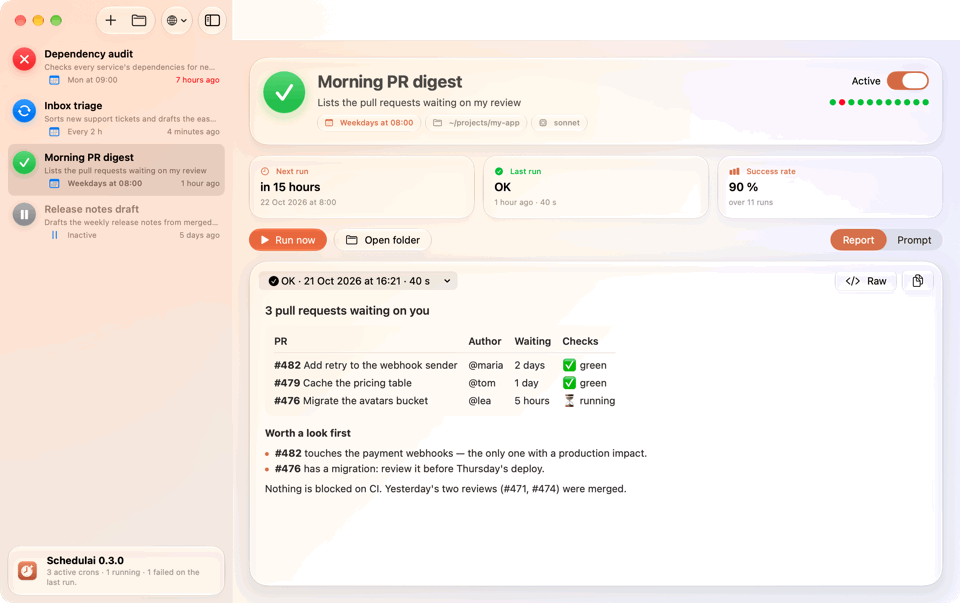

# SchedulAI

A macOS app that runs your AI prompts on a schedule — with Claude Code, Codex or Gemini CLI.



Each job is a Markdown file — a prompt plus a few lines saying when to run it and which tools
it may use. SchedulAI hands it to the agent's headless mode (`claude -p`, `codex exec`,
`gemini -p`) through launchd, keeps every report, and shows the state of each job in the Dock,
the menu bar and its window. It also ships a skill for all three agents, so you can ask a
session to build the job for you: *"every Monday at 9, list my PRs still waiting on a review"*.

Built with SwiftUI and AppKit for macOS 26 (Liquid Glass): a Swift package,
`scripts/build-app.sh`, an ad-hoc-signed bundle.

## A job is a folder

`~/.claude/scheduled/<id>/prompt.md`:

```markdown
---
name: Morning PR digest
description: Lists my open PRs waiting on a review
schedule: weekdays 08:00
workdir: ~/projects/my-app
agent: claude            # optional: claude (default), codex or gemini
allowedTools: "Bash(gh pr list:*),Bash(gh pr view:*)"
model: sonnet            # optional, passed as is to the agent
---
The prompt. End it with the report you want to read.
```

- `schedule`: `08:00`, `daily 08:00`, `weekdays 08:00`, `mon,thu 09:30`, `08:00, 14:00`,
  `every 30m`, `every 2h` (French day names work too).
- The permission keys are the job's whole permission set: nobody is there to approve a call.
  Each agent has its own:

  | `agent:` | Permission keys |
  |---|---|
  | `claude` | `allowedTools`: `"Bash(gh pr list:*),mcp__github__get_pr"` — exactly these tools |
  | `codex` | `sandbox`: `read-only` (default), `workspace-write`, `danger-full-access`; `network: true` to let commands reach the network |
  | `gemini` | `approval`: `default` (only `allowedTools` pass), `auto_edit`, `yolo`; `allowedTools`: `"run_shell_command(gh pr list)"` |

  `schedulai check <id>` flags a key the job's agent ignores, and an agent that is not installed.

Each run writes `logs/<stamp>.log` (the report), `status.json`, a line of `history.jsonl`, and
posts a notification.

## The app

- **Window** — every job with its state, next run, success rate and last runs; the report
  rendered from Markdown (or raw); the prompt editable in place, name and description included;
  right-click a job (or press Delete) to run, pause or delete it — its folder goes to the Trash.
- **Menu bar** — a clock with a sparkle (a dot when a run failed); its menu lists the jobs,
  runs or pauses them, and holds *Open at login*, *Language* and *Check for Updates…*.
- **Dock** — a badge counts the failed jobs; right-click for the same job menu.
- **Languages** — English and French; follows macOS until you pick one.
- **Updates** — the app checks this repository's latest release after launch and twice a
  day, verifies the download against its SHA-256 and installs it, waiting for any running job.

## From your agent

The `schedulai` skill — installed by the app into `~/.claude/skills/`, and into
`~/.codex/skills/` and `~/.gemini/skills/` when you use Codex or Gemini CLI — turns a description into
a job: it does the task once in the session, writes a self-contained prompt with exactly the
tools it used, test-runs it and switches it on. It drives the `schedulai` command, which goes
through the app's own code:

```
schedulai list | check <id> | run <id> | enable <id> | disable <id> | delete <id> | dir | version
```

## Install

Requirements: macOS 26, Apple Silicon, and at least one of
[Claude Code](https://docs.anthropic.com/en/docs/claude-code/setup),
[Codex](https://github.com/openai/codex) or [Gemini CLI](https://github.com/google-gemini/gemini-cli),
signed in once from a terminal. Without one, the app says so and every run fails with that reason.

From a release: download `Schedulai.zip` from
[Releases](https://github.com/cparis-ts/schedulai/releases), unzip into `/Applications`, then
— the app is not notarized yet — clear the quarantine once and open it:

```bash
xattr -dr com.apple.quarantine /Applications/Schedulai.app && open /Applications/Schedulai.app
```

The app installs the skill, the `schedulai` command (`~/.local/bin`) and the job runner itself.

From source (Xcode 26):

```bash
scripts/install.sh   # build, copy to /Applications, open
```

## The animation above

It shows sample jobs, never your own: `SCHEDULAI_DEMO=<dir>` makes the app read its jobs from
`<dir>` and leave launchd alone, and `SCHEDULAI_TOUR=1` makes it walk through them on its own
while its window is captured frame by frame (`screencapture -l <window>`).

## Release

Push a tag: `git tag v0.3.0 && git push origin v0.3.0`. The *Release* workflow builds the app
stamped with that version and publishes `Schedulai.zip` and `Schedulai.zip.sha256`; installed
copies pick it up on their next check.

## License

MIT — see [LICENSE](LICENSE). Issues and pull requests are welcome.
